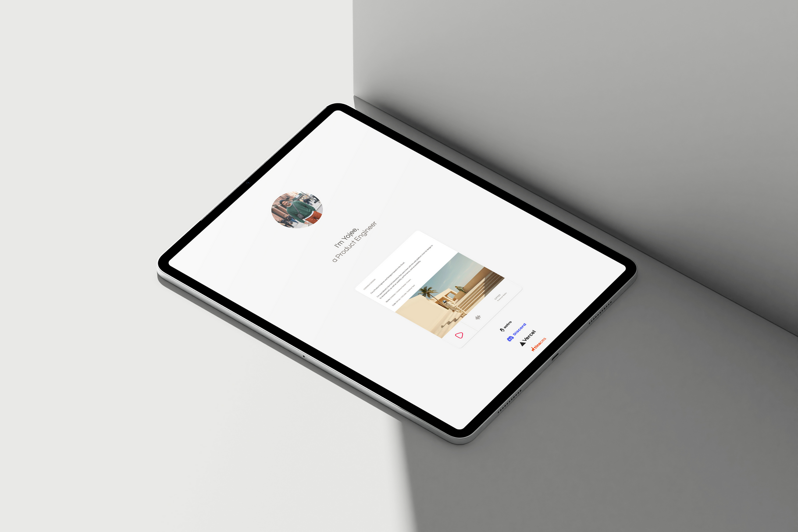
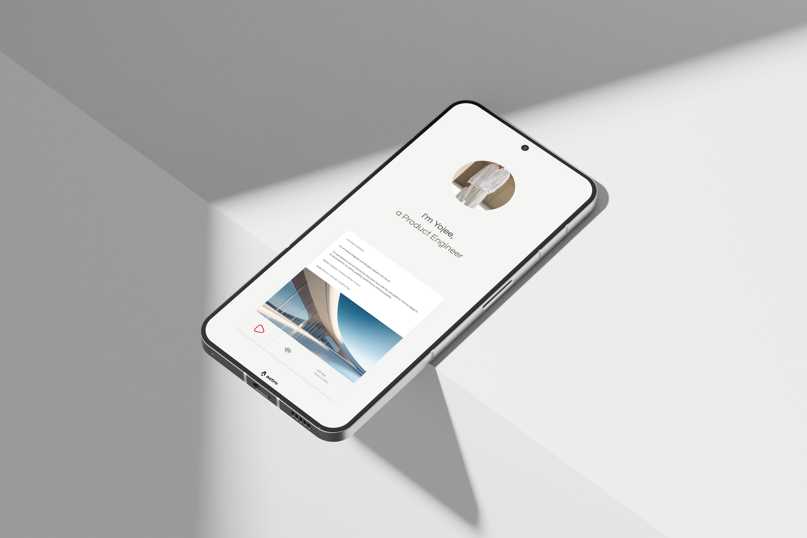
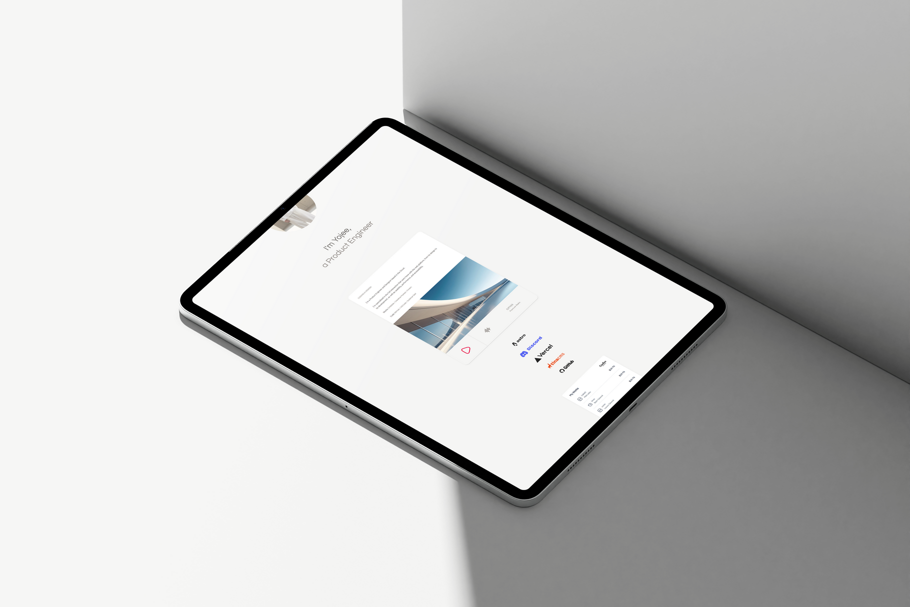

Features 🧼   

- Clean UI  
- Online Radio 
- SEO-Friendly   
- Responsive Design  
- Cloud & Static Hosting Ready
- 100% Lighthouse Performance

#### Tech Stack   
```
Bun | Vite | Biome | Tailwind CSS | Vanilla JS
```   

#### Commands

All commands are run from the root of the project:

| Command           | Action                                          |
| :---------------- | :---------------------------------------------- |
| `bun install`     | Installs dependencies                           |
| `bun run dev`     | Starts local dev server at `localhost:4321`     |
| `bun run build`   | Builds the production site to `./dist/`         |
| `bun run preview` | Previews the build locally                      |
| `bun run check`   | Lints + formats (Biome, applies safe fixes)     |
| `bun run ci`      | Non-mutating Biome check for CI                 |   

